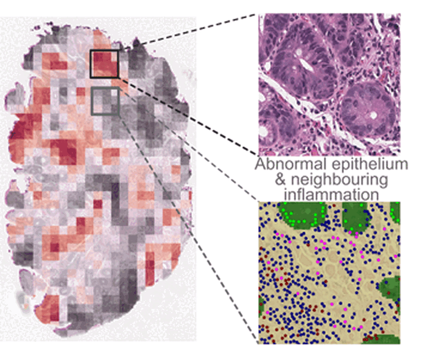

Most patients with Barrett's oesophagus never progress to adenocarcinoma, yet surveillance is applied broadly, which leads to overtreatment of a low-risk majority. Progression is driven by a combination of genomic and microenvironmental factors, but existing predictive models rarely capture both, and almost never from the routine specimens that are already collected in clinical practice.

BEACON (**B**arrett **E**sophagus DNA content **A**bnormality and immune e**c**ology for cancer **O**utcome) addresses this gap. It is a spatially aware framework that recovers a molecular readout and an immune-ecological readout from the same H&E slide, then integrates the two spatially for risk stratification. This page describes the preprint version of the work; the full pipeline is openly available.

## Framework

BEACON is built from three components:

1. **DACOR** (DNA content abnormality recognition) — a multiple-instance learning model that predicts DNA content abnormality (aneuploidy) directly from H&E whole-slide images, using a fine-tuned REMEDIS foundation model as the tile feature extractor.
2. **Spatial immune ecology** — paired cell classification and tissue segmentation models (CellViT-plus-plus and SegFormer) that support a suite of spatial statistics: density, Ripley's L, Moran's I, Getis-Ord Gi\*, Morisita-Horn, k-nearest-neighbour distance, and the G-function, all computed relative to epithelial structures.
3. **Risk stratification** — a penalised logistic regression (LASSO) model integrating the molecular readout, immune ecology metrics, and epithelial morphology into a single progression risk classification.

The models were developed on the BEAR dataset: 777 Barrett's oesophagus biopsies with matched flow cytometry DNA content data, scanned at two institutions, with a discovery cohort from MD Anderson and an independent test cohort from Northwestern.

## Key findings

- DACOR predicted DNA content abnormality with **0.825 AUC** in the independent test cohort.
- DNA content abnormal regions showed increased lymphoplasmacytic inflammation relative to normal regions (p = 0.006).
- Patients classified as DNA content abnormal by DACOR showed significantly increased cancer progression (p = 0.0001).
- Among DNA content abnormal patients, progressors showed increased plasma cell clustering adjacent to abnormal epithelium compared with non-progressors.
- The integrated model stratified DNA content abnormal patients into high- and low-risk groups with **0.817 AUC**.

Together this shows that a molecular abnormality and its surrounding immune response can be read from the same routine slide, and that where the immune response sits relative to the abnormal epithelium carries risk information beyond the abnormality itself.

## Code and models

- [**GitHub repository**](https://github.com/caner-ercan/BEACON) — full inference and fine-tuning pipeline, with Docker images for each stage
- [**Zenodo archive**](https://doi.org/10.5281/zenodo.17583572) — fine-tuned model weights (DACOR, CellViT, SegFormer, LASSO risk model) and manual annotations
- [**Preprint**](https://doi.org/10.1101/2025.11.11.25339952) — medRxiv, 2025

The base REMEDIS model is not redistributed here; it is available from [PhysioNet](https://physionet.org/content/medical-ai-research-foundation/1.0.0/) on registration. Code is released under GPL-3.0.

## Meeting presentations

- [**Evolutionary Biology and Ecology of Cancer**](https://coursesandconferences.wellcomeconnectingscience.org/event/evolutionary-biology-and-ecology-of-cancer-20250630/) — Poster. Wellcome Genome Campus, Hinxton, UK, 30 June – 3 July 2025
- [**EMBO Workshop: The Many Faces of Cancer Evolution**](https://meetings.embo.org/event/26-cancer-evo) — Short talk. Rimini, Italy, 27–29 May 2026
- [**3rd Conference of the European Society for Spatial Biology**](https://essb2026.org/) — Poster. Sitges, Spain, 28 September – 1 October 2026 (upcoming)

## Grant

- [Deep learning-based whole-slide image analysis for immune ecology and cancer prediction in Barrett's oesophagus](https://data.snf.ch/grants/grant/214162), SNSF, Postdoc.Mobility 2023
